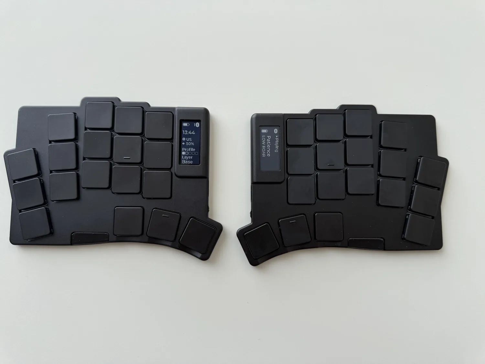
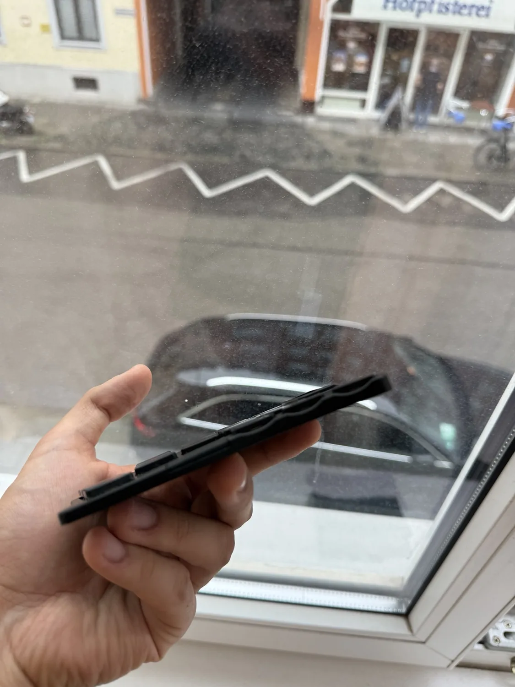

# Wafer

A 36-key wireless split keyboard with Kailh PG1316S switches, two nice!view
displays, and a 4–8 mm aluminium enclosure with magnetic coupling between halves.
This repository contains its ZMK board support, firmware configuration, and
nPM1300 battery driver.

[Project page, more photos & design story](https://oleksandrmaslov.github.io/portfolio/Wafer.html)
· [Build guide](docs/building.md) · [Board files](boards/waferboard/wafer/README.md)

## At a glance

| Specification | Details |
| --- | --- |
| Layout | 36 keys; 18 per half |
| Switches | Kailh PG1316S ultra-thin butterfly switches |
| Controller | ISP1807 SiP with nRF52840 and integrated antenna |
| Power | nPM1300 PMIC; 250 mAh LiPo per half |
| Displays | One nice!view memory LCD per half |
| Connection | Bluetooth LE and USB; ZMK on Zephyr |
| Enclosure | Machined aluminium; 4–8 mm profile depending on location; magnets |
| Status | Working prototype; enclosure fit and manufacturing tolerances are still being refined |

## Firmware

`main` uses the standard QWERTY layout. The separate
[`personal-layout`](https://github.com/oleksandrmaslov/wafer-zmk-config/tree/personal-layout)
branch contains the daily-use keymap.

| Component | Default | Source |
| --- | --- | --- |
| Split power button, hold-to-wake, USB-only bootloader gesture | Enabled | External [zmk-soft-off-plus](https://github.com/oleksandrmaslov/zmk-soft-off-plus) |
| Battery reporting from the PMIC ADC | Enabled | Local [npm1300_vbat driver](modules/npm1300_vbat/) |
| Local nice!view status screen | Enabled | [Board widgets](boards/waferboard/wafer/widgets/) |
| Host-driven display and Raw HID relay | Opt-in | External [zmk-split-hid-display](https://github.com/oleksandrmaslov/zmk-split-hid-display) |

Run the [build workflow](https://github.com/oleksandrmaslov/wafer-zmk-config/actions/workflows/build.yml)
on your fork to get left and right UF2 files. Check **hid_display** when starting
a manual run to also build the optional display profile. The photos show that
optional profile. See the [build guide](docs/building.md) for local builds,
flashing, custom keymaps, USB logs, and bond recovery.

The canonical stock keymap is [wafer.keymap](boards/waferboard/wafer/wafer.keymap).
Copy it to `config/wafer.keymap` to customize it; put ordinary Kconfig overrides
in [config/wafer.conf](config/wafer.conf).

| Power-button gesture | Action |
| --- | --- |
| Hold for about 1.8 seconds, then release | Turn both connected halves off |
| Hold each half's button for 1.5 seconds | Wake that half |
| Triple-tap while that half is connected by USB | Enter its UF2 bootloader |

[Standard layout](assets/wafer_layout_default.svg) · [Build validation](docs/validation.md)
· [Branch/history notes](docs/branches.md)

## A closer look

  
  
  

## Hardware files

PCB designs, BOM, fabrication outputs, CNC STEP models, and the thread drawing
are in the separate local repository `../wafer-keyboard/`. That repository has
not been published to GitHub yet. See the [repository and licensing guide](docs/hardware-repository.md).

## Licence

| Material | Licence |
| --- | --- |
| Firmware code, keymaps, devicetrees, configuration, and software documentation outside `assets/` | [MIT](LICENSE) |
| Photos, artwork, and the illustrated layout | [CC BY-NC 4.0](assets/LICENSE); [attribution and sources](assets/README.md) |
| PCB/CAD files in `wafer-keyboard` | CC BY-NC 4.0 with explicit personal-fabrication permission; commercial production requires separate permission |

Copyright © 2025 The ZMK Contributors and © 2026 Oleksandr Maslov. Existing
third-party notices and licences remain applicable.

## Credits

Inspired by [TOTEM](https://github.com/GEIGEIGEIST/TOTEM) and
[Mikefive](https://github.com/mikeholscher/zmk-config-mikefive).
PCB help: [Rasmus Koit](https://github.com/rasmuskoit) and
[Eden](https://github.com/galaxyeden). Case consultation:
[Vlad Vodkin](https://t.me/vlad30303).
