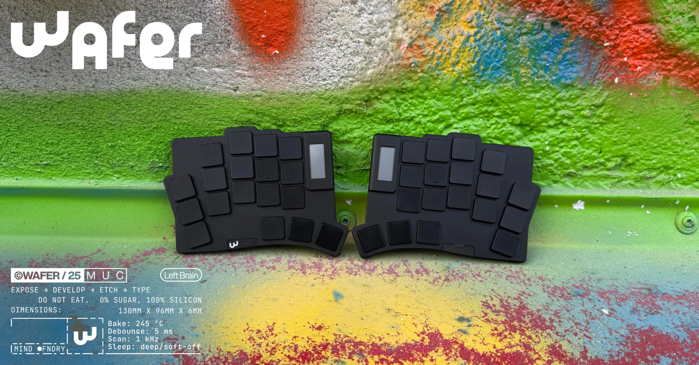
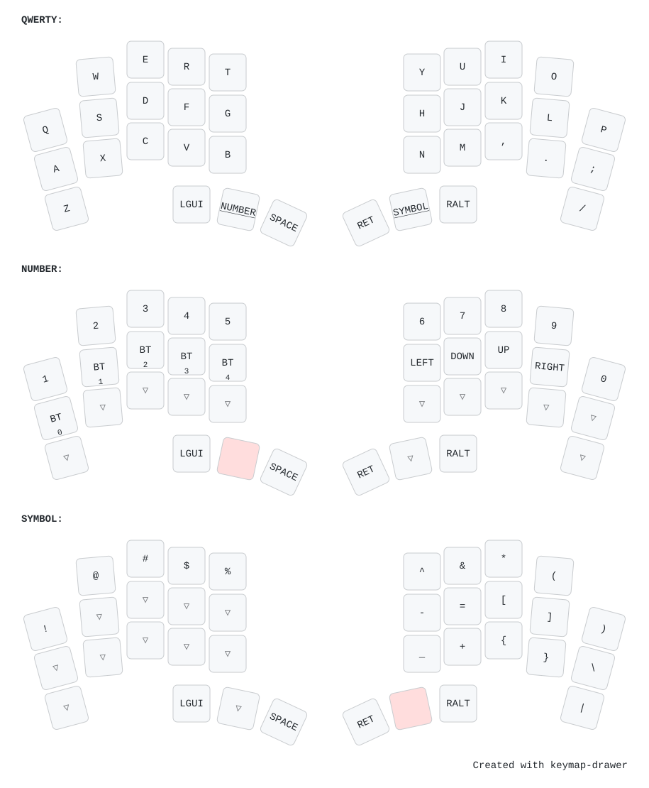
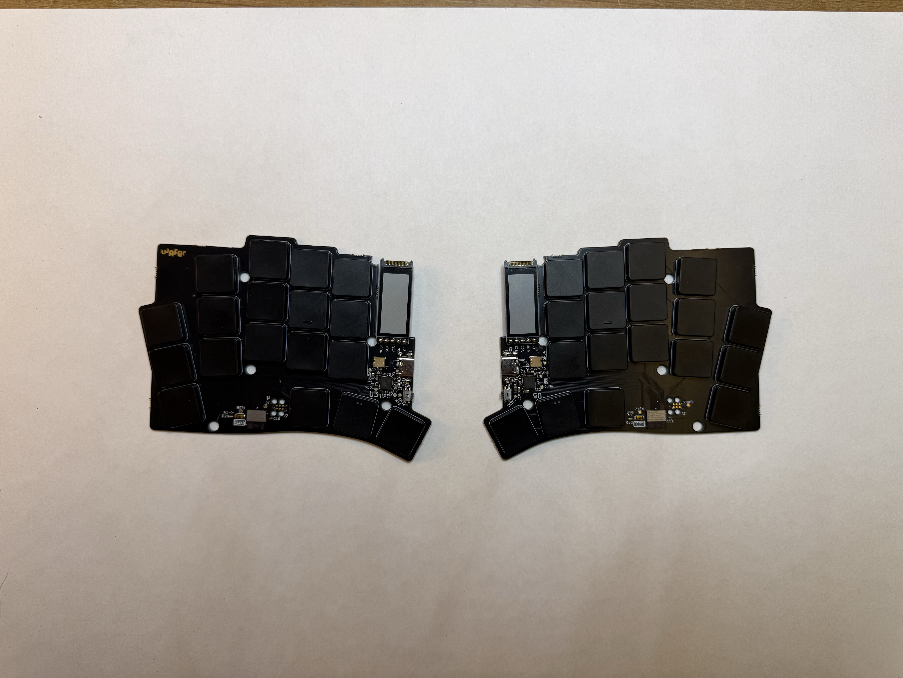
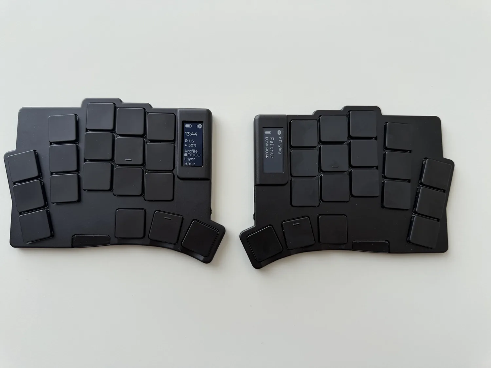
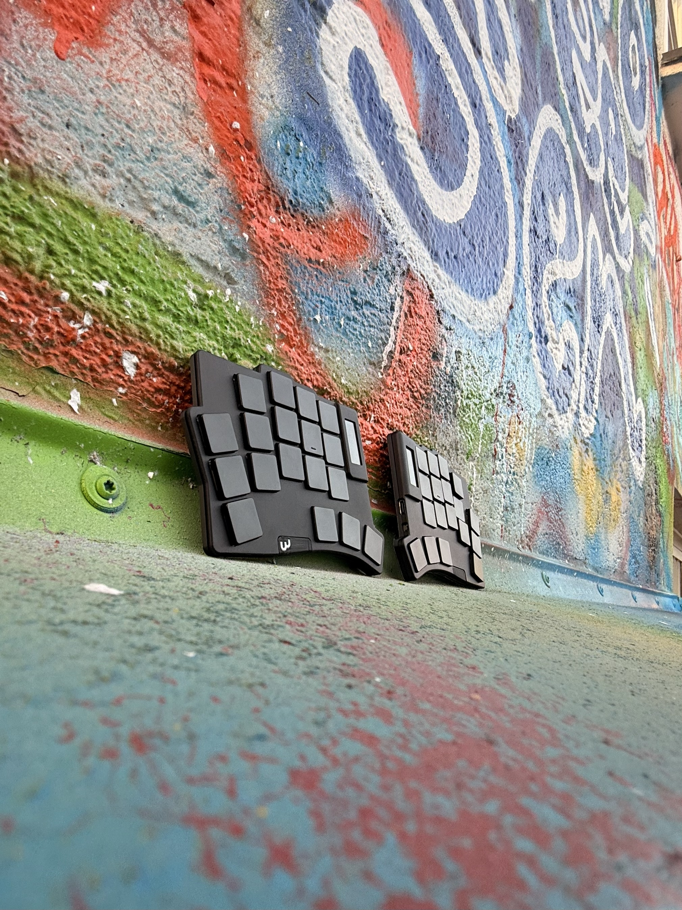
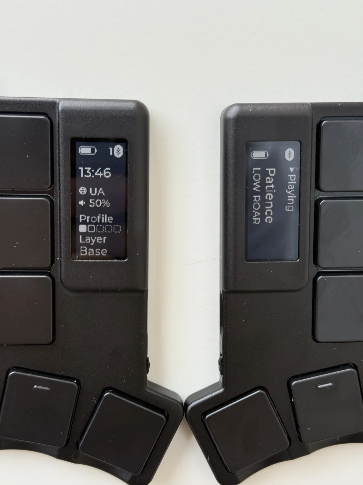
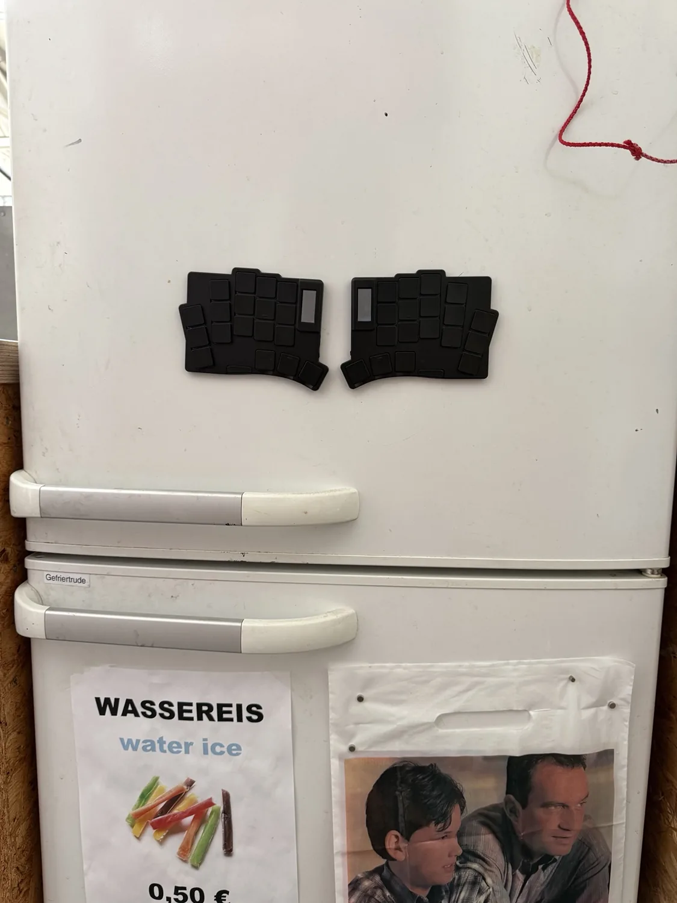
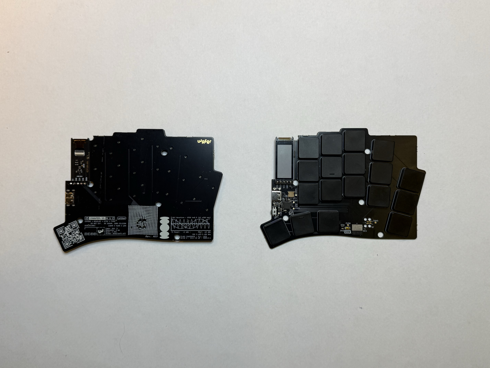
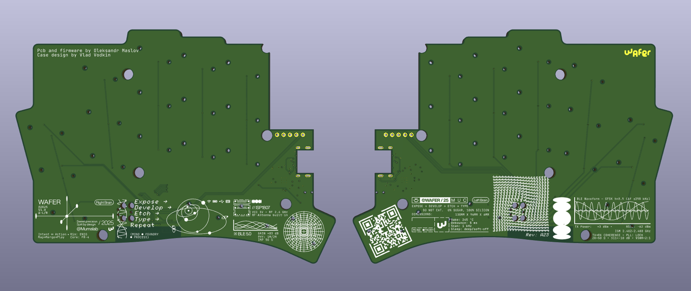

# Wafer

**A wireless split keyboard 4–8 mm thick, in a CNC aluminium case held together
by magnets.**

[Project page](https://oleksandrmaslov.github.io/portfolio/Wafer.html) ·
[Build journal on Hack Club Blueprint](https://blueprint.hackclub.com/projects/2800) ·
[PCB and case files](https://github.com/oleksandrmaslov/wafer-keyboard) ·
[Build and flashing guide](docs/building.md)

Wafer is a 36 key ultra-thin split keyboard that stays between 4–8 mm thick,
depending where you measure it. It runs on an ISP1807 with an nPM1300 PMIC, and
the full aluminium case snaps together with magnets for a clean profile.
Kailh PG1316S switches, a nice!view display and a 250 mAh LiPo in each half.
It runs ZMK over Bluetooth LE or USB.

| | |
| --- | --- |
| Thickness | 4–8 mm |
| Keys | 36, split |
| Switches | Kailh PG1316S with custom springs |
| Controller | ISP1807 (nRF52840) in each half |
| Power | nPM1300 PMIC, 250 mAh LiPo in each half |
| Display | nice!view (memory-in-pixel) on each half |
| Case | CNC-milled aluminium, magnetic |
| Connection | Bluetooth LE or USB |
| Firmware | ZMK |

***

## USE WAFER'S FIRMWARE ON YOUR KEYBOARD

You don't need a Wafer to use the firmware work behind it. These run on other
ZMK keyboards too:

- [zmk-split-hid-display](https://github.com/oleksandrmaslov/zmk-split-hid-display):
  your computer sends the time, volume, keyboard layout and the song that's
  playing over Raw HID. The central half passes it to the other half, so both
  nice!views show it. Built on zzeneg's
  [zmk-raw-hid](https://github.com/zzeneg/zmk-raw-hid) and
  [zmk-nice-view-hid](https://github.com/zzeneg/zmk-nice-view-hid).
- [zmk-soft-off-plus](https://github.com/oleksandrmaslov/zmk-soft-off-plus):
  one dedicated power button turns off both halves. Also hold-to-wake, a
  USB-only bootloader gesture and a deep-sleep wake guard.
- [nPM1300 battery driver](modules/npm1300_vbat/): battery reporting for
  boards with an nPM1300 PMIC.
- [Wafer Studio](https://github.com/oleksandrmaslov/wafer-studio): a faster
  keymap editor for any ZMK Studio keyboard. Press a key to bind it, paint
  home-row mods across a row, copy a layer and change only what differs.

***

## LAYOUT

Default layout is shown above; layers and firmware live in this repo. `main`
keeps the standard QWERTY layout, and my daily-use keymap is on
[`personal-layout`](https://github.com/oleksandrmaslov/wafer-zmk-config/tree/personal-layout).
Copy [wafer.keymap](boards/waferboard/wafer/wafer.keymap) to `config/wafer.keymap`
to change it, and put your other settings in [config/wafer.conf](config/wafer.conf).

The default build keeps the local nice!view status screen and
[zmk-soft-off-plus](https://github.com/oleksandrmaslov/zmk-soft-off-plus).
Hold the power button for about 1.8 seconds, then release it to turn both
connected halves off. On battery, hold each half's button for 1.5 seconds to
wake it. USB wake bypass allows a short press when USB power is detected.
Triple-tap the plugged-in half's button while awake to enter its bootloader.

The [nPM1300 battery driver](modules/npm1300_vbat/) lives here. Soft-off-plus and
[zmk-split-hid-display](https://github.com/oleksandrmaslov/zmk-split-hid-display)
stay in their own separate repos. The HID display module is optional and adds
the host information shown in the newer display photos. Check **hid_display** in a manual
[build workflow](https://github.com/oleksandrmaslov/wafer-zmk-config/actions/workflows/build.yml)
run to build that version too.

[Build and flashing guide](docs/building.md) ·
[Board files](boards/waferboard/wafer/README.md) ·
[Build validation](docs/validation.md)

***

## PCB

[Here](https://github.com/oleksandrmaslov/wafer-keyboard/tree/main/pcb) you can
find the PCB and production files in the separate `wafer-keyboard` repo. There
are two versions, with mousebites for production and without them.

***

## BOM

The full Bill of Materials is in the hardware repo:

- [BOM (JLCPCB production)](https://github.com/oleksandrmaslov/wafer-keyboard/blob/main/pcb/jlcpcb/production_files/BOM-wafer_keyboard_v3_production.csv)
- [Component placement](https://github.com/oleksandrmaslov/wafer-keyboard/blob/main/pcb/jlcpcb/production_files/CPL-wafer_keyboard_v3_production.csv)
- [Original price breakdown](https://github.com/oleksandrmaslov/wafer-keyboard/blob/main/pcb/Keyboard%20Price.csv)

***

## CASE

These models are for CNC:

- [Left case STEP](https://github.com/oleksandrmaslov/wafer-keyboard/blob/main/case/wafer_case_left.step)
- [Right case STEP](https://github.com/oleksandrmaslov/wafer-keyboard/blob/main/case/wafer_case_right.step)
- [Thread drawing](https://github.com/oleksandrmaslov/wafer-keyboard/blob/main/case/Wafer%20threads%20drawing.pdf)

See the [hardware repo guide](docs/hardware-repository.md) for the file split and
personal-build permissions.

***

## PHOTOS

  
  
  

Art on the back:

And in KiCad:

If you like Wafer, a star on GitHub helps other people find it. Built something
with these modules? Open an issue with a photo, I'd love to see it.

***

## LICENSE

### Software source code and firmware configuration

Firmware code, keymaps, devicetrees, configuration and software documentation use
the [MIT License](LICENSE). This includes the physical-layout definitions ZMK
needs to use the keyboard.

### Photos, artwork and hardware designs

Photos, renders, artwork and the illustrated layout use
[CC BY-NC 4.0](assets/LICENSE). You can share and modify them for noncommercial
use with attribution. [Photo sources and credits](assets/README.md).

PCB/CAD files in `wafer-keyboard` also use CC BY-NC 4.0, with explicit permission
for personal builds, modifications and paying a fabricator for your own copies.
Commercial production needs separate written permission. The
[licensing guide](docs/hardware-repository.md) explains the scope and contact.

Copyright (c) 2025 The ZMK Contributors and (c) 2026 Oleksandr Maslov. Existing
third-party notices and earlier licence grants remain applicable.

***

## CREDITS

### INSPIRATION

Inspired by [TOTEM](https://github.com/GEIGEIGEIST/TOTEM) by GEIST and
[mikefive](https://github.com/mikeholscher/zmk-config-mikefive) by Mike Hölscher,
but with a slimmer profile and magnets for usability. Big thanks to Rasmus for introducing me to the ISP1807.

### HELP FIXING THINGS

People who helped me create this board and fix stuff:

#### PCB

- [Rasmus Koit](https://github.com/rasmuskoit)
- [Eden](https://github.com/galaxyeden)
#### CASE

- [Vlad Vodkin (consulted me to build this case, huge thanks)](https://t.me/vlad30303)
