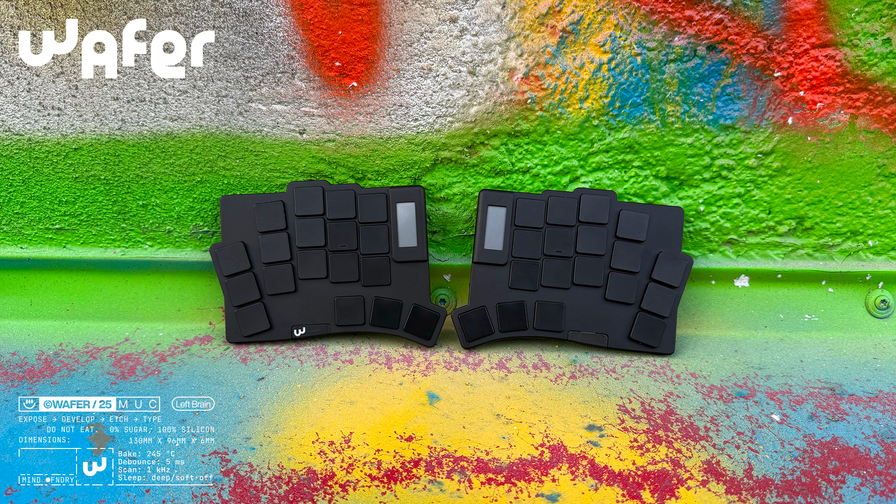
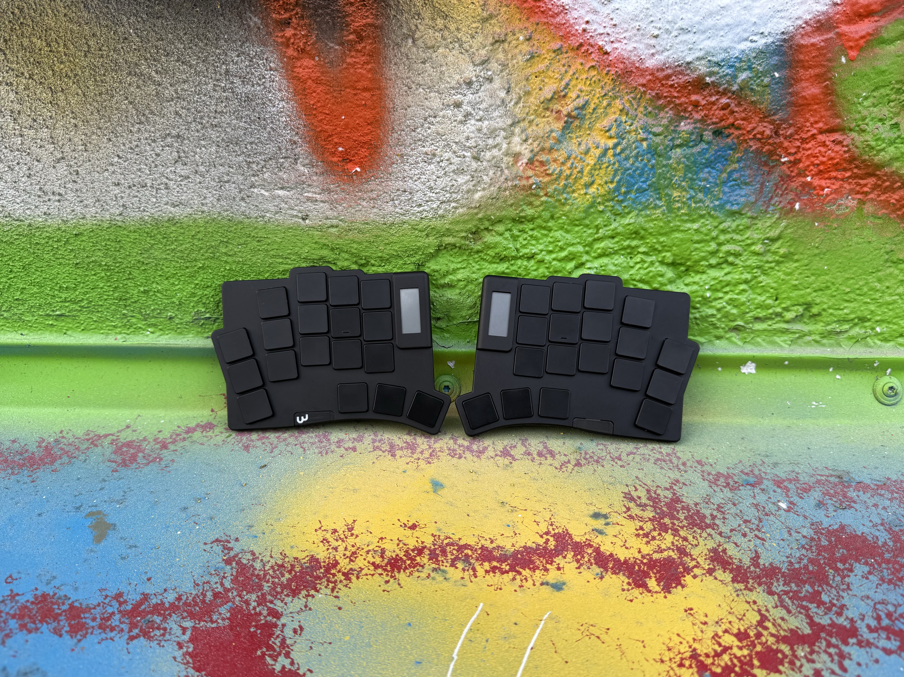
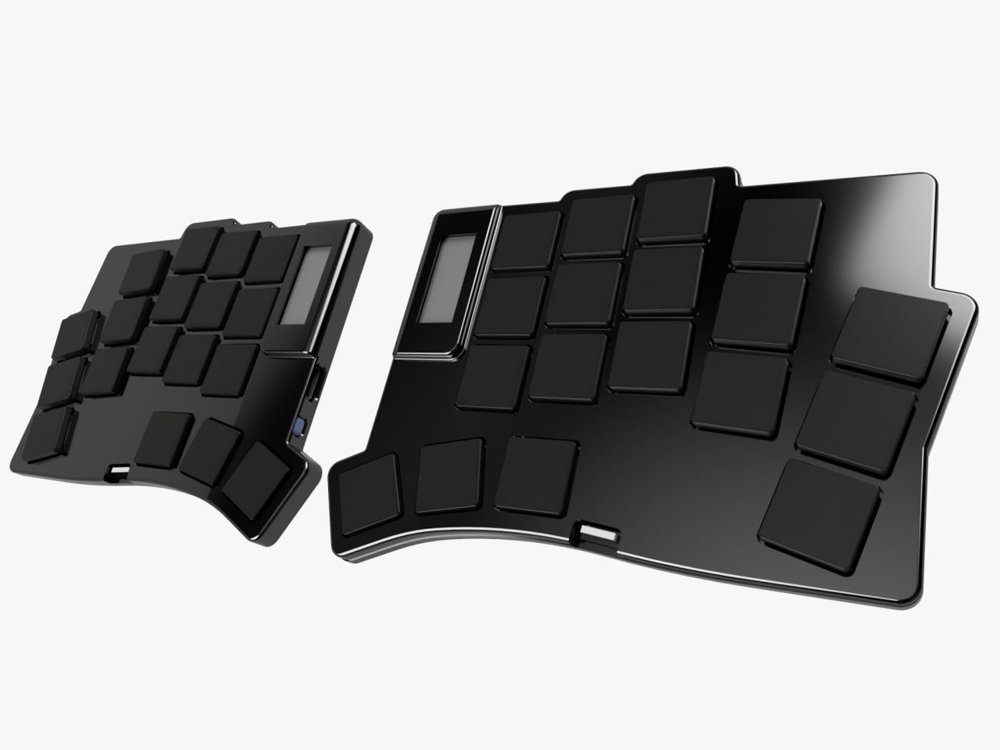

# Wafer



Wafer is a 36 key ultra-thin split keyboard that stays between 4–8 mm thick. It runs on an ISP1807 with an NPM1300 PMIC, and the full aluminium case snaps together with magnets for a clean profile. Runs ZMK for ultra-low-power

***

## Firmware

`main` provides the standard 36-key QWERTY layout. `personal-layout` remains the
separate daily-use layout. Shared board fixes are taken from personal-layout,
without its custom keymap, keyboard name, or host-language settings.



```text
boards/waferboard/wafer/  board hardware, shared power/PMIC/display trees, stock keymap
dts/                    physical layout and the battery sensor binding
modules/npm1300_vbat/    local PMIC battery driver
config/                 default manifest and user overrides
config/hid-display/     opt-in external HID display module manifest
snippets/               optional feature configuration and overlays
```

The default manifest adds only `zmk-soft-off-plus` to upstream ZMK. Battery
reporting and the existing local nice!view status widget remain board features.
The power button keeps the tested behavior: hold for about 1.8 seconds to turn
both connected halves off, release to finish powering off; hold each half's
button for 1.5 seconds to wake it. Triple-tap enters the bootloader on the
USB-connected half. A powered-off half must be woken separately.

### Builds

Push to your fork or run the **build** GitHub Actions workflow for the default
`wafer_left` and `wafer_right` UF2 files. The board's `wafer.keymap` is the single
stock keymap. To customize it, copy it to `config/wafer.keymap`; user keymaps
override the board default. Put ordinary Kconfig overrides in `config/wafer.conf`.

For a local build from a fresh directory with the ZMK toolchain installed:

```sh
mkdir wafer-workspace
cd wafer-workspace
git clone https://github.com/oleksandrmaslov/wafer-zmk-config.git wafer
mkdir config
cp wafer/config/west.yml config/west.yml
west init -l config
west update
west build -s zmk/app -d build/left -b wafer_left -- -DZMK_CONFIG="$PWD/wafer/config" -DZMK_EXTRA_MODULES="$PWD/wafer"
west build -s zmk/app -d build/right -b wafer_right -- -DZMK_CONFIG="$PWD/wafer/config" -DZMK_EXTRA_MODULES="$PWD/wafer"
```

### Optional HID display

This profile enables host-driven nice!view data and the split Raw HID relay.
On GitHub, run **build** manually with **hid_display** checked. Pull requests
also compile this profile to check it alongside the default firmware; its UF2s
are in the separate `firmware-hid-display` archive.

For a separate local workspace, initialize with the optional manifest:

```sh
mkdir wafer-hid-workspace
cd wafer-hid-workspace
git clone https://github.com/oleksandrmaslov/wafer-zmk-config.git wafer
mkdir config
cp wafer/config/hid-display/west.yml config/west.yml
west init -l config
west update
west build -s zmk/app -d build/hid-left -b wafer_left -S wafer-hid-display -- -DZMK_CONFIG="$PWD/wafer/config/hid-display" -DZMK_EXTRA_MODULES="$PWD/wafer"
west build -s zmk/app -d build/hid-right -b wafer_right -S wafer-hid-display -- -DZMK_CONFIG="$PWD/wafer/config/hid-display" -DZMK_EXTRA_MODULES="$PWD/wafer"
```

The two manifests pin the same ZMK and soft-off revisions. Keep these pins in
sync when upgrading. The optional profile additionally pins the HID module.
Set `CONFIG_NICE_VIEW_HID_LAYOUTS` in the snippet to match your host app's language
order (default `US`). Custom keymap/config overrides for this profile belong in
`config/hid-display/`. Normal builds have no Raw HID interface or relay.

For USB logs, add `-S zmk-usb-logging` to a default local build. To recover bonds,
build each half with `-DCONFIG_ZMK_SETTINGS_RESET_ON_START=y`, boot both recovery
images once, then flash normal firmware. Recovery images erase persistent
settings on every boot; keep them separate from ordinary firmware.

After building, verify the generated firmware configuration and device tree with
`python tests/check_builds.py /path/to/zephyr /path/to/build/left /path/to/build/right`
from the firmware repository, using your build environment's Python. Include the
HID build directories in the same check when built.

[Board file guide](boards/waferboard/wafer/README.md) ·
[Branch review](docs/branches.md) ·
[Build validation](docs/validation.md) ·
[Hardware repository and licensing](docs/hardware-repository.md)

The structure follows [ZMK's module guidance](https://zmk.dev/docs/development/module-creation).
PCB and case sources have been moved to the sibling local repository
`../wafer-keyboard/`. Product photographs and firmware layout data remain here.
Firmware uses MIT; photos and artwork use CC BY-NC 4.0. The hardware repository
uses CC BY-NC 4.0 with explicit personal-fabrication permission.

***

## Hardware

The editable KiCad files, BOM, fabrication outputs, CNC STEP models, and thread
drawing now live in the separate local repository `../wafer-keyboard/`:

```text
wafer-keyboard/
  pcb/     KiCad sources, BOM, Gerbers, fabrication outputs and original backups
  case/    CNC STEP models and thread drawing
  LICENSE  standard CC BY-NC 4.0 licence
  MANUFACTURING.md  personal-fabrication permission and commercial terms
```

The hardware repository has not been published on GitHub yet. Its files and
hardware-related history were preserved before removal from this working tree.
The [licensing guide](docs/hardware-repository.md) explains personal builds,
modifications, paid fabrication of personal copies, and commercial permission.

***

## PHOTOS







***

## Licence

Copyright (c) 2025 The ZMK Contributors; copyright (c) 2026 Oleksandr Maslov.
Existing third-party notices and licences remain applicable.

| Material | Licence | What it allows |
| --- | --- | --- |
| Firmware code, keymaps, devicetrees, configuration, and software documentation outside `assets/` | [MIT](LICENSE) | Reuse and modification, including commercial software use, with the copyright/licence notice. |
| Photos, renders, artwork, and the illustrated layout in `assets/` | [CC BY-NC 4.0](assets/LICENSE) | Noncommercial sharing and modification with attribution, a licence link, and notice of changes. |
| PCB/CAD design files in the separate `wafer-keyboard` repository | CC BY-NC 4.0 + personal-fabrication permission | Personal builds and modifications, including paid fabrication of personal copies; commercial production requires separate permission. |

The full standard licence texts are included unchanged apart from the MIT
copyright attribution. See [asset attribution](assets/README.md) and the
[hardware licensing guide](docs/hardware-repository.md) for scope and commercial
contact. These licences grant only rights the respective licensor holds;
third-party material and trademarks retain their own applicable terms.

***

## CREDITS

### INSPIRATION

Inspired by the [Totem Keyboard](https://github.com/GEIGEIGEIST/TOTEM) and [Mikehive](https://github.com/mikeholscher/zmk-config-mikefive), but with a slimmer profile and magnets for usability. Big thanks to Rasmus for introducing me to the ISP1807.

### HELP FIXING THINGS

People who helped me create this board and fix stuff:

#### PCB
- [Rasmus Koit](https://github.com/rasmuskoit)
- [Eden](https://github.com/galaxyeden)
#### CASE
- [Vlad Vodkin (consulted me to build this case, huge thanks)](https://t.me/vlad30303)

