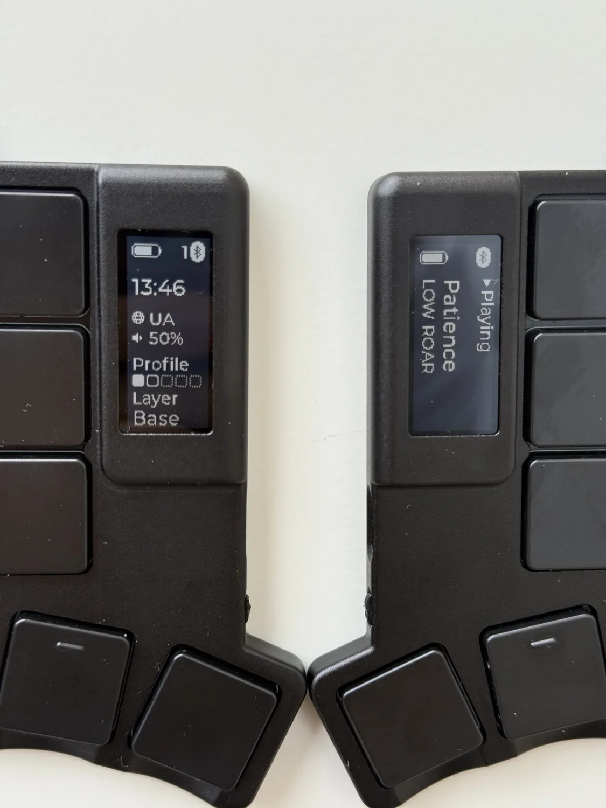
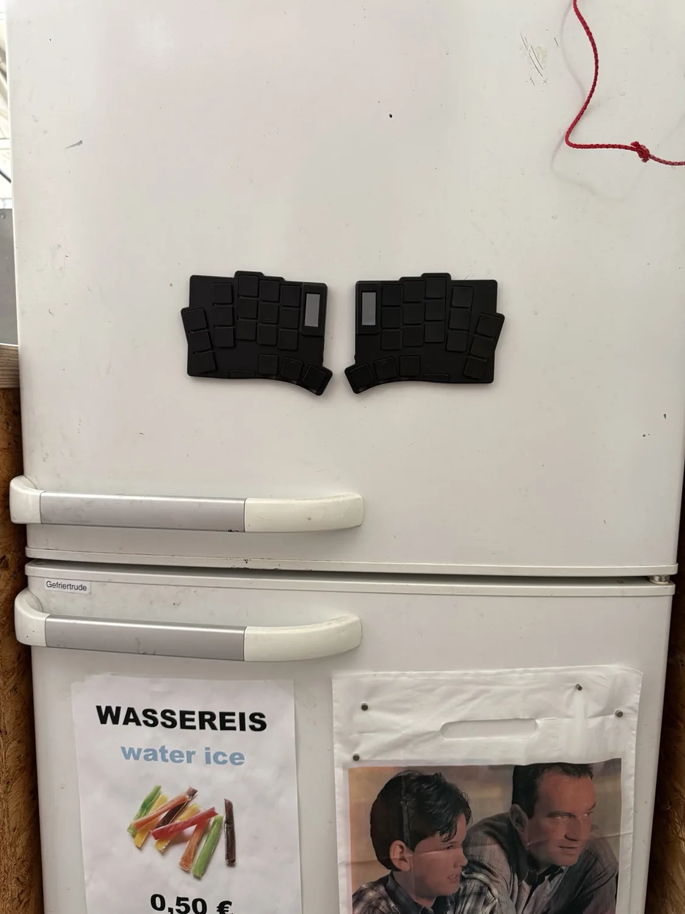

# Wafer

Wafer is a 36 key ultra-thin split keyboard that stays between 4–8 mm thick,
depending where you measure it. It runs on an ISP1807 with an nPM1300 PMIC, and
the full aluminium case snaps together with magnets for a clean profile.
Kailh PG1316S switches, a nice!view display and a 250 mAh LiPo in each half.
It runs ZMK over Bluetooth LE or USB.

The electronics and firmware work. The case has been made, but fit and
manufacturing tolerances still need work. More photos and the full story are on
[the project page](https://oleksandrmaslov.github.io/portfolio/Wafer.html).

***

## LAYOUT

Default layout is shown above; layers and firmware live in this repo. `main`
keeps the standard QWERTY layout, and my daily-use keymap is on
[`personal-layout`](https://github.com/oleksandrmaslov/wafer-zmk-config/tree/personal-layout).
Copy [wafer.keymap](boards/waferboard/wafer/wafer.keymap) to `config/wafer.keymap`
to change it, and put your other settings in [config/wafer.conf](config/wafer.conf).

The default build keeps the local nice!view status screen and
[zmk-soft-off-plus](https://github.com/oleksandrmaslov/zmk-soft-off-plus).
Hold the power button for about 1.8 seconds, then release it to turn both
connected halves off. Hold each half's button for 1.5 seconds to wake it;
triple-tap the button on a USB-connected half to enter its bootloader.

The [nPM1300 battery driver](modules/npm1300_vbat/) lives here. Soft-off-plus and
[zmk-split-hid-display](https://github.com/oleksandrmaslov/zmk-split-hid-display)
stay in their own separate repos. The HID display module is optional and adds
the host information shown in the newer display photos. Check **hid_display** in a manual
[build workflow](https://github.com/oleksandrmaslov/wafer-zmk-config/actions/workflows/build.yml)
run to build that version too.

[Build and flashing guide](docs/building.md) ·
[Board files](boards/waferboard/wafer/README.md) ·
[Build validation](docs/validation.md) · [Branch notes](docs/branches.md)

***

## PCB

The PCB and production files now live in the separate `wafer-keyboard` repo,
under `pcb/`. There are two versions, with mousebites for production and without
them. The hardware repo is still local at `../wafer-keyboard/`; I'll add its
public link once it is published.

***

## BOM

The full Bill of Materials is in `wafer-keyboard/pcb/`:

- BOM for JLCPCB assembly: `jlcpcb/production_files/BOM-wafer_keyboard_v3_production.csv`
- Component placement: `jlcpcb/production_files/CPL-wafer_keyboard_v3_production.csv`
- Original prototype price breakdown: `Keyboard Price.csv`

***

## CASE

These models are mostly for CNC right now. The left and right STEP files and the
thread drawing are in `wafer-keyboard/case/`. The enclosure has been produced and
iterated, but the fit and tolerances still need refining before another run.
See the [hardware repo guide](docs/hardware-repository.md) for the file split and
personal-build permissions.

***

## PHOTOS

  
  
  

Art on the back:

And in KiCad:

***

## LICENSE

### Software source code and firmware configuration

Firmware code, keymaps, devicetrees, configuration and software documentation use
the [MIT License](LICENSE). This includes the physical-layout definitions ZMK
needs to use the keyboard.

### Photos, artwork and hardware designs

Photos, renders, artwork and the illustrated layout use
[CC BY-NC 4.0](assets/LICENSE). You can share and modify them for noncommercial
use with attribution. [Photo sources and credits](assets/README.md).

PCB/CAD files in `wafer-keyboard` also use CC BY-NC 4.0, with explicit permission
for personal builds, modifications and paying a fabricator for your own copies.
Commercial production needs separate written permission. The
[licensing guide](docs/hardware-repository.md) explains the scope and contact.

Copyright (c) 2025 The ZMK Contributors and (c) 2026 Oleksandr Maslov. Existing
third-party notices and earlier licence grants remain applicable.

***

## CREDITS

### INSPIRATION

Inspired by the [Totem Keyboard](https://github.com/GEIGEIGEIST/TOTEM) and [Mikehive](https://github.com/mikeholscher/zmk-config-mikefive), but with a slimmer profile and magnets for usability. Big thanks to Rasmus for introducing me to the ISP1807.

### HELP FIXING THINGS

People who helped me create this board and fix stuff:

#### PCB

- [Rasmus Koit](https://github.com/rasmuskoit)
- [Eden](https://github.com/galaxyeden)
#### CASE

- [Vlad Vodkin (consulted me to build this case, huge thanks)](https://t.me/vlad30303)
