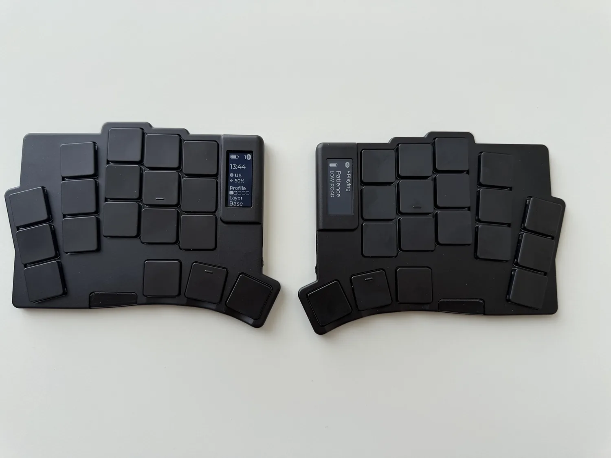
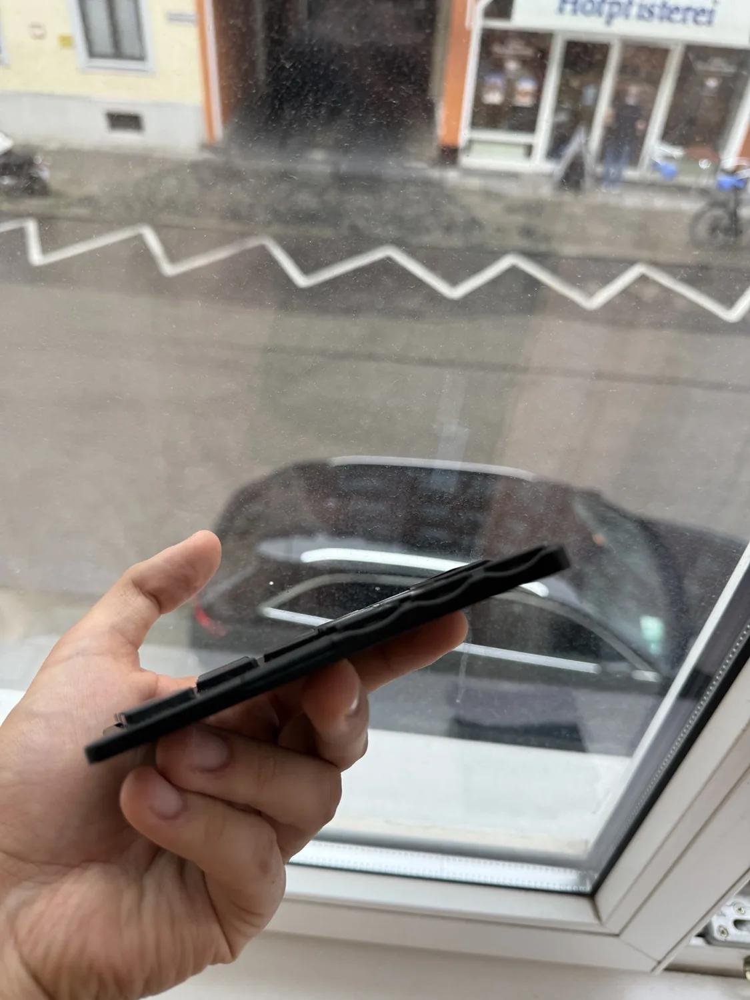
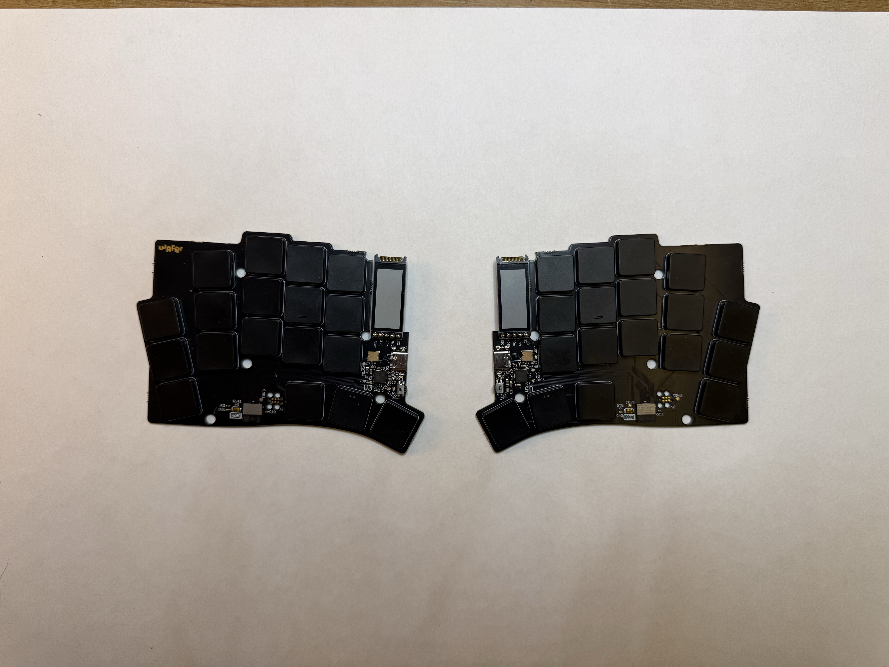
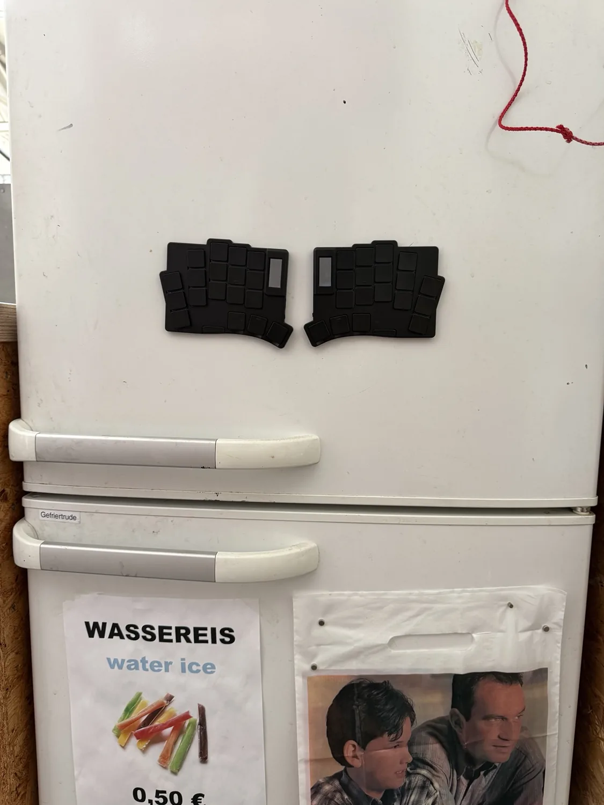
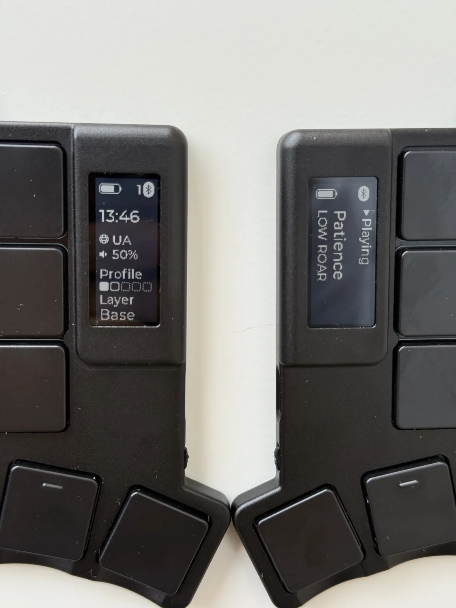
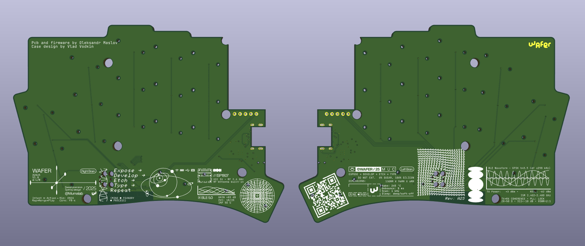

# How I built Wafer

Wafer is a 36-key wireless split keyboard. It's 4 mm thick at the thinnest
point and 8 mm where the display sits. The nRF52840 and the power management
sit right on the key PCB, the case is CNC aluminium, and the magnets inside the
case hold the halves together, on a fridge or on a MagSafe stand.

It's also the first PCB I ever designed. This is the whole story, mistakes
included, from a hand outline in March 2025 to the keyboard I type on now. The
firmware is in this repo, and the PCB, BOM and case files are in
[wafer-keyboard](https://github.com/oleksandrmaslov/wafer-keyboard). It's not
for sale, but you're welcome to build your own.

## March 2025: an itch and a hand outline

I didn't have a plan. I just wanted my own board with stagger. I'd already
built three splits, the last one a wireless low-profile Corne, so splits weren't
new to me. I could print, solder and flash my own ZMK config. Designing the PCB
itself was a different story. Eww.

So I outlined my hand and sketched a first concept. I remember thinking "hey,
that's hella nice". I already knew I wanted 36 keys, the minimal layout I'd got
used to. A Ben Vallack video led me to [Ergogen](https://ergogen.xyz), a way to
write a keyboard layout as code and get KiCad files out of it. For a beginner
that felt like cheating, in a good way.

<!-- photo: the first Ergogen outline from the journal -->

## The devboard sandwich

While I played with layouts, one thing kept bothering me about every DIY
wireless build I'd seen, mine included. The stack is always the same: key PCB,
battery, devboard, display. It works and it's easy, but the devboard and its pin
headers eat a lot of height, and the battery is still small.

So the idea was simple. If the devboard is what makes the build thick, put its
parts on the key PCB and cut a pocket for the battery. It's nothing new in
manufacturing, but back then I'd barely seen a split keyboard do it. (Maybe I
should look at something other than Reddit lol.)

## First PCB: "I'll just borrow Mikoto"

I started with the most beginner move possible: zero knowledge, peak
confidence. The plan was:

- take the MCU layout from Mikoto, an open-source nRF52840 devboard made for
  JLCPCB production
- add a nice!view display
- add a key matrix I learned from a Joe Scotto video
- jump straight into routing

I also went with a soft-off button instead of a physical battery switch. That
decision was actually decent.

The catch: Mikoto is a bare MCU. Bare means you're responsible for all the
painful parts: decoupling, routing around the nRF52840 and, scariest of all,
the antenna. Think I accounted for that? Keep thinking.

Laying out my first PCB took almost three weeks, and I had to fix the board
outline before I could even place parts. The result was a 6-layer board whose
routing still scares me, with a 2.4 GHz antenna footprint I picked more or less
at random. I redid the board twice more from scratch. Don't be like me.

<!-- photo: the first layout from the journal -->

## How thin can it actually be?

Right after that first layout I wanted to know how thin this thing could really
get. A friend from my makerspace who knew Fusion helped me prototype cases, just
to test the shape.

The first prints were humbling. We made the display opening smaller than the
display, and didn't notice for almost a week, because the nice!view 3D model we
used was much smaller than the real PCB. Then we learned that electronics take
height as well as area, so the pockets and cutouts had to get a lot more
aggressive. My Corne already had that snap-together feel, so we added flat round
magnets too.

Even with all that, the first prototype came out at 5 mm at the thinnest part
and 8 mm at the display. Later I got the thinnest part down to about 4 mm.

## Ordering from China

Once Wafer stopped being a layout experiment, I had to buy real parts. Switches
were the big one. Instead of a small batch from a shop, I ordered from Kailh
directly, to save money and to get lighter springs.

There are a few PG1316 versions. The PG1316S is the classic ultra-thin SMD
laptop switch, and it's what Wafer uses. The PG1316C is slightly heavier and
supports hot-swap; I've made a footprint for it but haven't tested it yet. The
PG1316M is a smaller format that usually sits in the top row of full-size
keyboards.

Kailh quoted the PG1316S at $0.42 each for 500, $0.37 for 1000 and $0.34 for
3000, with keycaps at $0.08. For comparison, a shop charged $0.75 per switch
plus $0.45 per keycap.

The nice!view-style displays came from China too, at about $10 each, and so did
the N52 magnets. I couldn't find N52 magnets this thin in Germany at all. Ten of
them cost me $3.

## Revision two: goodbye bare MCU

After the Mikoto experiments I accepted the obvious: a bare nRF52840 isn't
beginner friendly, and even less so on an ultra-thin board. Rasmus introduced me
to the ISP1807, an nRF52840 system-in-package with everything the MCU needs
inside an 8x8x1 mm BGA, antenna included. Instead of spending weeks guessing
whether my impedance control was secretly sabotaging everything, I could focus
on what mattered: power, the matrix and the thin stack.

I also changed the PG1316S footprint and made the contact pads bigger, so hand
soldering leaves fewer cold joints.

## Power, three times

The first power design was the classic nice!nano-style one: a BQ24075 charger
plus a MAX17048 fuel gauge, because I really wanted a proper battery percentage.
Then the obvious question hit me: why am I not using a proper PMIC? The
nice!nano layout is optimised for cheap mass production. For one keyboard, a
couple of dollars in BOM didn't matter, while efficiency and space did.

Version two used Nordic's nPM1100, a tiny PMIC with a charger and a buck
converter. Fewer parts meant fewer routing traps and more room. Swapping the LDO
for a buck took efficiency from about 78% to about 92%, which is close to 20%
more battery life for free. It only charges at up to 400 mA instead of 1.5 A,
and for a 250 mAh battery that doesn't matter at all.

Version three is the one in Wafer now, the nPM1300. It handles charging, the
power rails and battery readings, and I can control all of it over I2C:

- It has two buck converters. I use the 3.0 V one, which plays well with the
  nice!view.
- Its load switches cut power to external parts. The display sits on one, so
  ZMK can turn it off with its external power control.
- The charging current is set in devicetree, anywhere from 32 mA to 800 mA, and
  the charger also handles the cut-off voltage and thermal monitoring.

Nordic also advertises a fuel gauge, but it's a software estimator that needs a
battery profile made with their profiling kit. For one keyboard that didn't make
sense, so ZMK reads the battery voltage from the PMIC directly (more on that
below).

For production I made a panelised version where both halves are joined by
mousebite tabs, so the factory gets one board instead of two.

## Soldering

The factory assembled part of each board: the charger section and most of the
tiny passives. The hard parts I soldered myself, the PG1316S switches and the
ISP1807. That was tougher than I expected, with the fine pitch, the alignment
and the sheer amount of manual work, but everything seated and the board came to
life. I also printed antenna covers with my logo on them on a multi-material
printer.

## The case: 30+ prints and one bad CNC run

The case turned into a project of its own. It was never going to be a box around
a PCB, and since the goal was CNC aluminium, every choice affected the next one.
I printed more than 30 revisions before I placed the first order.

The big lesson was that a 3D printer adds material and a CNC cuts it away, so
the drawing is really a plan for how the part gets machined. Fusion's free CNC
simulation helped a lot with seeing how the part would actually be cut.

I designed around a few zones: the display (its real size, not the 3D model's),
the PCB, the battery and a bit of wiring, the magnets and how the halves snap
together, access to the power button, and the screws and bosses. The first
version only had to fit and assemble. I sloped the case from the start to save
thickness and moved the standoffs into the case, so the screws only show on the
bottom.

When the board moved to the ISP1807, the case changed with it: a new display
pocket, an RF cutout over the antenna, bigger standoffs and pockets for the
MagSafe-style magnets in the bottom.

The top is a frame with cutouts for the switches. The bottom is a tight pocket
for the electronics, with room for the battery and magnets and openings for
USB-C and the side power button. The first CNC run still came back out of spec.
Tool wear, fixturing, tolerance stack-up and finishing can all push critical
dimensions off, even with good drawings. So that became one more iteration:
check the problem areas, tighten the tolerances and inspection points, and order
again.

## Magnets

The magnets started as a copy of my Corne's snap-together feel. They're N52 and
they sit inside the case, so there's nothing stuck on the outside. They snap the
halves together so Wafer fits in a pocket, and they hold it on a steel fridge,
which is my favourite photo of it. Ordinary MagSafe phone stands work too, so I
can tent the halves without sticking rings or plates on the case.
Lots of people already tent splits on MagSafe stands with stick-on rings. I just
wanted the magnets built in.

<!-- photo: Wafer tented on two MagSafe stands -->

## Firmware

Wafer runs ZMK on Zephyr 4.1. It started as a nice!nano shield with a custom
matrix. For a while I maintained two repos: this config repo, and a ZMK fork
based on Pete Johansson's Zephyr 4.1 work from before the official release,
because Wafer doesn't use standard parts. That meant a lot of "why is this build
failing again?".

### Battery

I wanted a battery percentage without a separate battery device or
an ADC divider. The driver talks to the nPM1300 over I2C, starts a VBAT
measurement, waits for the conversion, reads the result back, converts it to
millivolts and hands it to ZMK's normal LiPo curve. Today it's a small driver in
this repo, [modules/npm1300_vbat](../modules/npm1300_vbat/), and Wafer builds on
upstream ZMK.

### Power button

With a dedicated power button wired outside the keymap, ZMK's
soft off only turns off the half you press it on. I wrote
[zmk-soft-off-plus](https://github.com/oleksandrmaslov/zmk-soft-off-plus) so one
button turns off both halves: hold it for about 1.8 seconds and let go. Waking a
half on battery takes a 1.5 second hold, so an accidental press doesn't drain
the battery, and a triple-tap on USB opens the bootloader.

### Displays

[zmk-split-hid-display](https://github.com/oleksandrmaslov/zmk-split-hid-display)
lets my computer send the time, volume, keyboard layout and the song that's
playing over Raw HID. The left half relays it to the right half, so both
nice!views can show it. It's built on zzeneg's zmk-raw-hid and
zmk-nice-view-hid.

### Keymap editing

I also made
[Wafer Studio](https://github.com/oleksandrmaslov/wafer-studio), a fork of ZMK
Studio where you press the key you want instead of searching a list. It works
with any ZMK Studio keyboard.

## The logo and the back

I wanted a font-based logo that feels like the keyboard: soft corners, chunky
shapes, a bit playful. I started in Figma with a blocky placeholder font. The
vibe was great but readability was terrible, so I reshaped every letter by hand.
What made it click were superellipses (squircles). They're in a lot of modern
type and logos, and you'd never notice.

Then came the back silkscreen, inspired by TOTEM's. It turns the back of the PCB
into something you only find after unscrewing the case, like a hidden spec
sheet. It has tiny details you can stare at for a really long time, and that's
exactly the point.

## What it cost

Parts for one keyboard came to about €591 at prototype quantities. The full list
is in
[Keyboard Price.csv](https://github.com/oleksandrmaslov/wafer-keyboard/blob/main/pcb/Keyboard%20Price.csv).

| Part | EUR |
| --- | ---: |
| CNC case, both halves | 157 |
| PG1316S switches | 116 |
| SMT assembly | 105 |
| PG1316 keycaps | 78 |
| PCB prototype | 77 |
| nice!view displays, 2 | 44 |
| 250 mAh batteries, 2 | 14 |
| Total | 591 |

Most of that is small-quantity pricing. The case alone is about a quarter of it.

## What I'd do differently

- Start with a module like the ISP1807. The bare nRF52840 cost me more than one
  board.
- Measure the real parts. The nice!view model was smaller than the real board,
  and that cost us a week.
- Plan for height from day one. Every part takes more of it than the 3D model
  suggests.
- Expect the first CNC run to need another round, and give the shop clear
  inspection points.

## Files and thanks

- Firmware, keymap and the build and flashing guide: this repo
- PCB, BOM, gerbers and case STEP files:
  [wafer-keyboard](https://github.com/oleksandrmaslov/wafer-keyboard)

Wafer is inspired by [TOTEM](https://github.com/GEIGEIGEIST/TOTEM) by GEIST and
[mikefive](https://github.com/mikeholscher/zmk-config-mikefive) by Mike
Hölscher. Thanks to [Rasmus Koit](https://github.com/rasmuskoit) and
[Eden](https://github.com/galaxyeden) for PCB help, to Vlad Vodkin for the case
advice, and to my makerspace friend who taught me Fusion.
